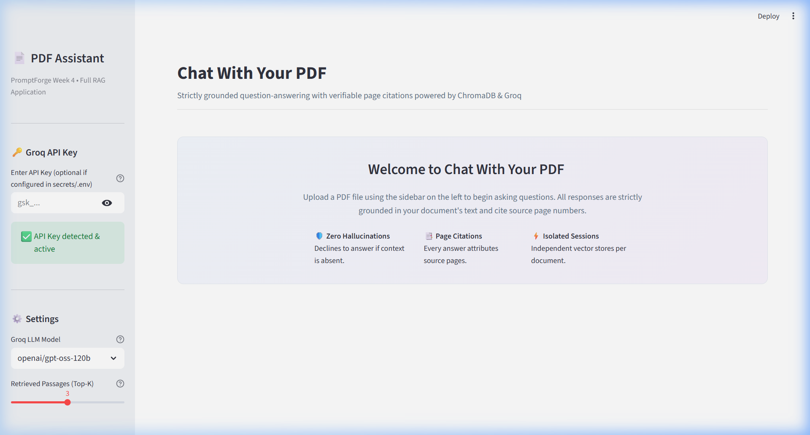
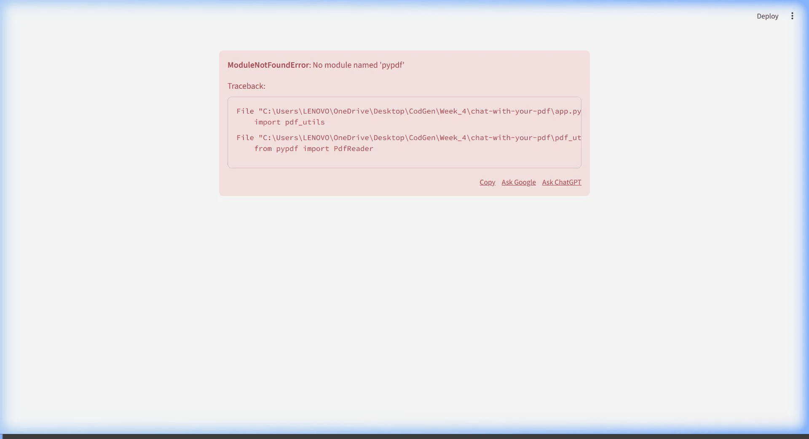

# Chat With Your PDF

> **A production-ready, strictly grounded Retrieval-Augmented Generation (RAG) web application that enables users to upload any PDF document, ask natural language questions, and receive accurate answers with verifiable page citations.**

---

## Demo & Visuals

### Application Interface & Verifiable Citations


### Walkthrough Animation


---

## Overview

Large Language Models (LLMs) are notorious for hallucinating facts when asked about domain-specific knowledge or private documents. **Chat With Your PDF** solves this fundamental trust issue by implementing an end-to-end Retrieval-Augmented Generation (RAG) architecture. 

When you upload a document, the application:
1. Extracts text while maintaining page-level attribution.
2. Slices content into overlapping semantic chunks.
3. Generates dense mathematical vector representations locally.
4. Indexes embeddings into an isolated, per-document vector database.
5. Performs semantic search to retrieve the most relevant passages for each question.
6. Enforces strict prompt grounding on high-speed Groq LLMs, preventing hallucinations and citing the exact page numbers supporting each claim.

If a question cannot be answered from the uploaded document, the system explicitly declines to answer with:  
> *"I don't know based on the provided PDF."*

---

## Features

- **Document Upload & Extraction:** Ingests text-based PDFs of any length using `pypdf`, handling complex layouts while preserving 1-indexed page boundaries. Full PDF upload workflow with validation, text extraction, and actionable error messages for scanned/encrypted/corrupted files.
- **Overlapping Chunking:** Implements sliding-word-window chunking (default: 250 words with 50-word overlap) to preserve semantic continuity across passage boundaries.
- **Local Sentence Embeddings:** Utilizes the lightweight, high-performance `all-MiniLM-L6-v2` transformer model (384 dimensions) running locally without third-party embedding API costs.
- **Isolated ChromaDB Vector Store:** Houses indexed document chunks in isolated collections scoped to the uploaded document's SHA-256 fingerprint, completely preventing cross-document retrieval contamination.
- **Strict Grounding (Zero Speculation):** Prompt-engineered guardrails force the model to answer exclusively from retrieved context. General-knowledge speculation is disallowed.
- **Verifiable Source Attribution:** Every answer displays an interactive source drawer detailing exact page numbers, similarity scores, and verbatim excerpts.
- **Persistent Multi-Turn Conversation:** Maintains conversational memory using `st.session_state` across Streamlit re-runs.
- **New Chat & Document Reset:** One-click session reset clears conversation history, resets ChromaDB query namespaces, and unloads active document state.
- **Dynamic Model Selection & Fallback:** Seamlessly supports high-speed Groq models (`llama-3.3-70b-versatile`, `qwen/qwen3.8-27b`, `openai/gpt-oss-120b`) with automated fallback handling.
- **Defensive Error Handling:** Gracefully detects and reports scanned PDFs (no text layer), corrupted files, password-protected documents, missing API keys, and network timeouts.

---

## Technology Stack

| Layer | Technology | Purpose |
| :--- | :--- | :--- |
| **User Interface** | [Streamlit](https://streamlit.io/) (1.30+) | Responsive, reactive chat interface with chat messages, file uploaders, and session state. |
| **PDF Extraction** | [pypdf](https://pypdf.readthedocs.io/) | Pure-Python PDF parsing, page extraction, and security/corruption validation. |
| **Embeddings** | [sentence-transformers](https://www.sbert.net/) (`all-MiniLM-L6-v2`) | Local dense semantic representations (384 dims) optimized for cosine similarity. |
| **Vector Database** | [ChromaDB](https://www.trychroma.com/) | Persistent HNSW vector indexing, similarity search, and collection namespace isolation. |
| **LLM Inference** | [Groq API](https://groq.com/) (LPU Engine) | Ultra-low latency LLM generation powering Llama 3 and state-of-the-art open models. |
| **Environment** | Python 3.10+ & `python-dotenv` | Clean secret management, dependency isolation, and cross-platform compatibility. |

---

## System Architecture & Workflow

The diagram below illustrates the complete data lifecycle from raw PDF ingestion to grounded answer generation:

```
[ User Uploads PDF ]
        │
        ▼
[ pdf_utils.py ] ──► Validate file, detect passwords/corruption
        │        ──► Extract text per page (Preserve 1-indexed page numbers)
        │        ──► Check for usable text layer (Detect scanned/image PDFs)
        │        ──► Slices into overlapping chunks (250 words / 50 overlap)
        ▼
[ rag_utils.py ] ──► Compute SHA-256 document fingerprint (doc_hash)
        │        ──► Generate 384-d embeddings with 'all-MiniLM-L6-v2'
        ▼
[ ChromaDB ] ──────► Create isolated collection: `pdf_<doc_hash>`
                     Store chunk texts, embeddings, page labels & metadata
═════════════════════════════════════════════════════════════════════════════
[ User Query ]
        │
        ▼
[ Query Embedding ] ──► Embed question with 'all-MiniLM-L6-v2'
        │
        ▼
[ ChromaDB Search ] ──► Cosine similarity search against active document collection
        │           ──► Retrieve Top-K most relevant chunks with page metadata
        ▼
[ Prompt Builder ]  ──► Formulate strict grounding system instructions
        │           ──► Inject retrieved context labeled with Page X
        ▼
[ Groq API LLM ]    ──► High-speed inference (Llama 3.3 / Qwen 27B / GPT-OSS 120B)
        │
        ▼
[ Streamlit UI ]    ──► Render grounded answer + expandable source citations
```

---

## Project Structure

```
chat-with-your-pdf/
├── app.py                      # Main Streamlit web application & session flow
├── pdf_utils.py                # PDF extraction, validation & overlapping chunking
├── rag_utils.py                # Embeddings, ChromaDB isolation, retrieval & Groq LLM
├── test_app.py                 # Automated unit test suite (extraction, chunking, storage)
├── test_e2e_grounding.py       # Live grounding verification test suite
├── final_reflection.md         # In-depth RAG architecture & engineering reflection
├── requirements.txt            # Minimal, pinned Python dependencies
├── .gitignore                  # Excludes .env, secrets, ChromaDB caches, pycache
├── .streamlit/
│   ├── config.toml             # Streamlit headless & theme configuration
│   └── secrets.toml.example    # Template for Streamlit secret configuration
└── assets/
    ├── app_screenshot.png       # Real screenshot of the running Streamlit app
    ├── demo.gif                 # Animated walkthrough demonstration
    └── sample_networking_guide.pdf # 3-page test PDF with verified page content
```

---

## Setup & Local Installation

### Prerequisites
- Python 3.10 or higher
- A free [Groq Cloud API Key](https://console.groq.com/keys)

### 1. Clone or Open the Repository
```bash
cd chat-with-your-pdf
```

### 2. Create and Activate a Virtual Environment

**Windows (PowerShell):**
```powershell
python -m venv venv
.\venv\Scripts\Activate.ps1
```

**macOS / Linux:**
```bash
python3 -m venv venv
source venv/bin/activate
```

### 3. Install Dependencies
```bash
pip install --upgrade pip
pip install -r requirements.txt
```

### 4. Configure Your Groq API Key

Choose one of two secure configuration methods:

**Option A — Streamlit Secrets (Recommended):**
```bash
cp .streamlit/secrets.toml.example .streamlit/secrets.toml
```
Open `.streamlit/secrets.toml` and paste your API key:
```toml
GROQ_API_KEY = "gsk_your_actual_key_here"
```

**Option B — Local `.env` File:**
Create a `.env` file in the project root:
```env
GROQ_API_KEY=gsk_your_actual_key_here
```

### 5. Launch the Streamlit Application
```bash
streamlit run app.py
```
Open your browser to: **`http://localhost:8501`**

---

## Testing & Verification

The project includes two comprehensive automated test suites:

### 1. Unit & Integration Test Suite (`test_app.py`)
Validates PDF extraction, page tracking, overlapping chunk boundary math, ChromaDB namespace isolation, and corrupt file handling:
```bash
python test_app.py
```
*Expected Output:* `Ran 7 tests in ~15s. OK`

### 2. Live End-to-End Grounding Verification (`test_e2e_grounding.py`)
Executes live RAG queries against Groq LLMs:
- **3 Answerable Queries:** Confirms answers cite exact factual content and page numbers (e.g., TCP 3-way handshake on Page 3, DNS port 53 fallback on Page 2, OSI Layer 3 on Page 1).
- **2 Unanswerable Queries:** Confirms model strictly returns *"I don't know based on the provided PDF."*
- **Edge Cases:** Tests blank scanned PDFs, corrupted files, empty queries, and placeholder API keys.
```bash
python test_e2e_grounding.py
```
*Expected Output:* `ALL END-TO-END RAG PIPELINE & GROUNDING TESTS PASSED PERFECTLY!`

---

## How to Use the Application

1. **Upload Document:** Click **Choose a PDF file** in the left sidebar and select any text-based PDF.
2. **Indexing:** Watch the real-time processing indicator as pages are parsed, chunked, and embedded into ChromaDB.
3. **Ask Questions:** In the bottom chat input, ask any question about the contents of the PDF.
4. **Inspect Sources:** Expand the **Retrieved Sources** drawer beneath the answer to inspect verbatim excerpts, page numbers, and cosine similarity scores.
5. **Switch / Reset:** Click **New Chat / Upload New PDF** in the sidebar anytime to purge conversational state and load a fresh document.

---

## Grounding Policy & Limitations

### Grounding Guarantee
Responses are strictly derived from the retrieved chunks of the uploaded document. If the document does not contain the necessary information, the model declines to answer rather than fabricating plausibly-sounding falsehoods.

### Current Limitations
- **Scanned / Image PDFs:** This application relies on native PDF text streams via `pypdf`. Scanned documents containing only raster images without an OCR text layer will trigger a clear warning indicating OCR is not supported.
- **Complex Multimodal Tables:** Highly complex multi-column tabular data or diagrams may lose spatial formatting during simple text extraction.
- **Context Window:** The retrieval layer provides the top-$k$ (default 3 to 5) most relevant passages. Queries requiring holistic synthesis of hundreds of disparate pages simultaneously may benefit from higher Top-K settings or hierarchical summarization.

---

## Core Architectural Pillars

- **LLM Orchestration & Prompt Guardrails:** Direct API integration, strict closed-domain system prompts, role management (`user`, `assistant`, `system`), low-temperature deterministic generation, and automatic fallback cascades.
- **Dense Vector Embeddings & Semantic Search:** Converting natural language into high-dimensional geometric spaces (`all-MiniLM-L6-v2`), cosine similarity matching, and semantic query alignment.
- **Persistent Vector Storage & Retrieval (ChromaDB):** Overlapping word chunking, persistent disk storage with HNSW indexing, and per-document isolated collection namespaces.
- **Full-Stack Application Engineering:** Slicing text with 1-indexed page-level attribution, isolated session state management, responsive Streamlit UI design, and automated test suites.

---

## Deployment

> **Status:** Local application fully implemented, tested, and ready for deployment to platforms such as Streamlit Community Cloud.

---

## License & Credits

Author: Open Source Contributor  
License: MIT
